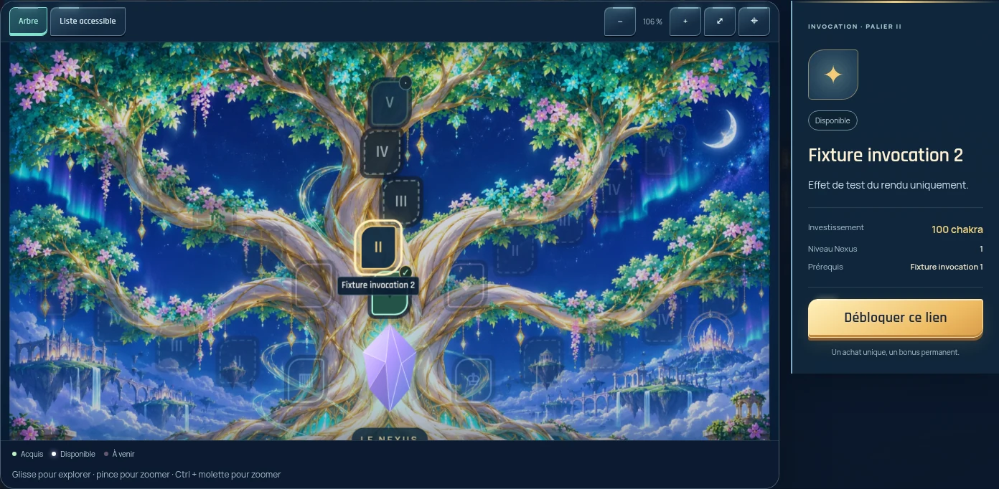
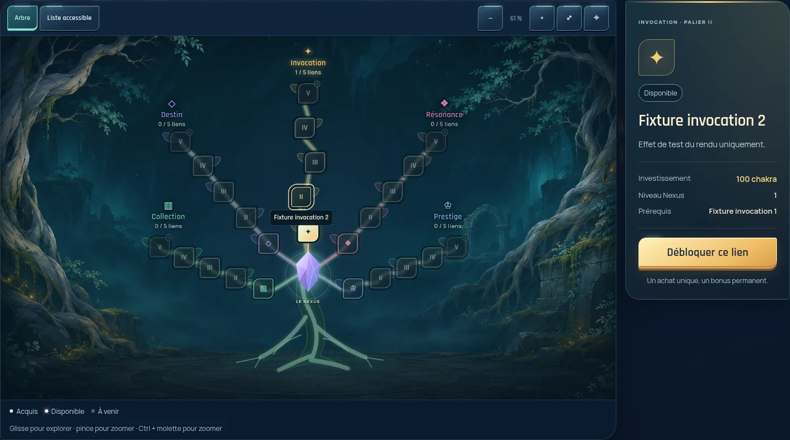
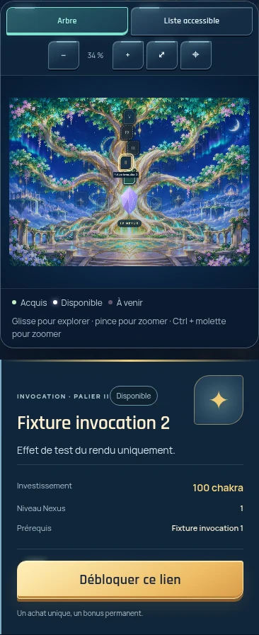
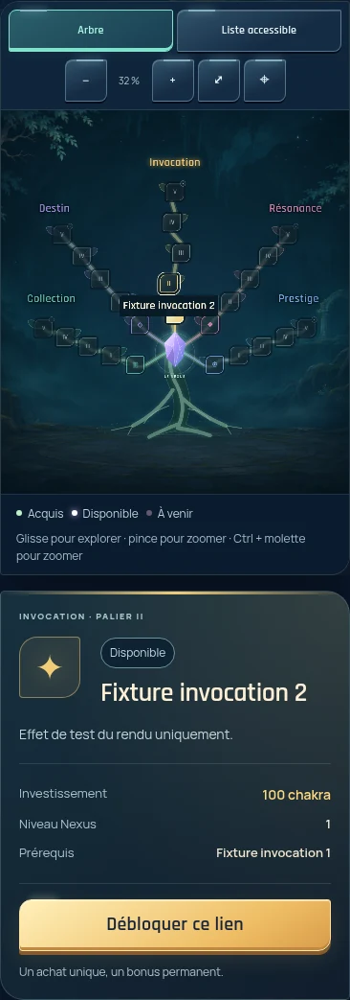
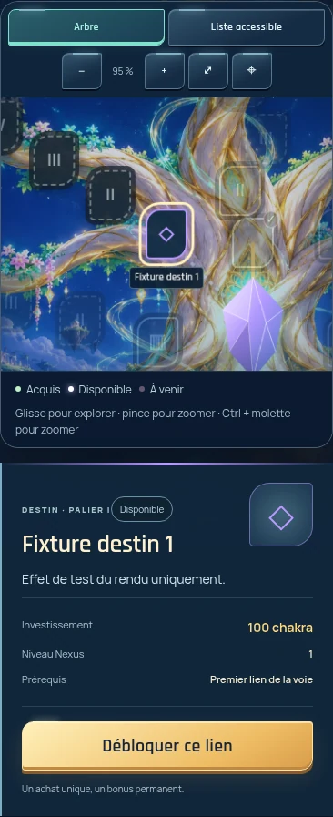
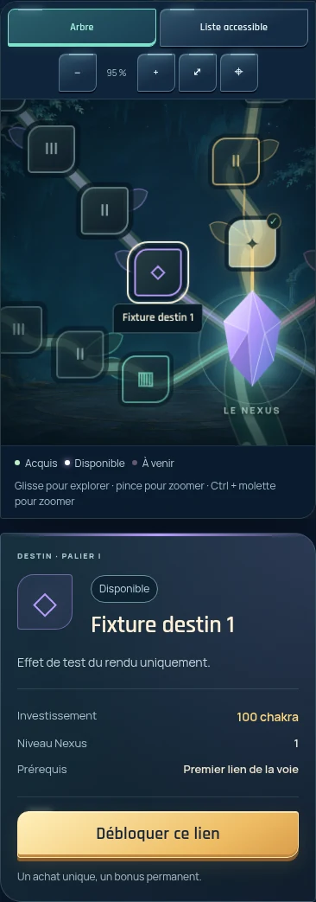

# Restauration de l’arbre du Nexus

L’arbre en SVG d’avant Rebirth est restauré sur la logique actuelle du Nexus. La branche part de `f5574ce` (dernier `main`). Aucun revert global, migration de données ou changement de l’économie.

## Version retrouvée

L’historique complet contient un seul dessin d’arbre antérieur à Rebirth : celui du commit `0325af2`, toujours présent dans `db6e977` et jusqu’à la première passe Rebirth. Le commit `aa990c1` supprime `treeScenery()`, déplace les nœuds et remplace le décor par `assets/rebirth/nexus-tree.webp`. Le commit `79a8c61` conserve ce remplacement et aplatit notamment le panneau de sélection.

| Élément d’origine | Source retrouvée et traitement |
| --- | --- |
| Tronc, racines, cinq branches, feuilles | `dist/kizuna-nexus.js` à `db6e977` : `treeScenery()`, `treePaths`, `treeHeart`, repris sans redessiner les tracés |
| Nœuds, liens entre prérequis, cristal | Dessin historique rétabli ; états et connexions calculés par le `renderGraph()` actuel, y compris un prérequis dans une autre branche |
| Forêt | `assets/art/kizuna-nexus-grove-v1.png`, toujours dans les archives de médias ; fichier extrait identique octet pour octet à `0325af2` |
| Palette, feuilles, nœuds sculptés, panneau | `dist/kizuna-art-nexus.css` existant, libéré des surcharges de remplacement de `kizuna-scenes.css` |
| Animations | Cristal, acquisition, accomplissement et récompenses existants conservés ; aucun effet déclenché par une simple lecture ou une réponse rejouée |

Empreinte SHA-256 du décor original : `61b43e3163df23be78291a3f97dd232edacf5ad3791bd9591f7aa59786af69db`.

Référence visuelle historique conservée : [ordinateur avant Rebirth](rebirth-finish/before-desktop-nexus.webp), [mobile avant Rebirth](rebirth-finish/before-mobile-nexus.webp).

## Comparaison avant / après cette restauration

Captures Chromium à 1440 × 1000 et 390 × 844, avec les mêmes 25 nœuds de test, une acquisition existante, des états verrouillés et des fonds insuffisants. Les noms « Fixture » et les coûts sont **des données simulées pour comparer l’affichage**, pas ceux d’un compte réel. Les captures de l’arbre incluent tout le panneau ; leur hauteur peut dépasser celle de l’écran mobile.

| Vue | Avant : dernier `main` | Après : arbre restauré |
| --- | --- | --- |
| Ordinateur, arbre complet |  |  |
| Mobile, arbre complet |  |  |
| Mobile, sélection de Destin |  |  |

Application complète en mode invité : [ordinateur avant](nexus-restoration/before/desktop-guest.webp), [après](nexus-restoration/after/desktop-guest.webp), [mobile avant](nexus-restoration/before/mobile-guest.webp), [après](nexus-restoration/after/mobile-guest.webp).

## Finitions et périmètre

- Cadrage de l’ensemble : racines et titres inclus, avec marge. Le zoom arrière reste cohérent sur petit écran ; toucher une voie agrandit et recentre son nœud actuel.
- Panneau d’origine retrouvé, texte à 14 px, coûts et prérequis à 13 px, commandes à 44 px. Les noms des nœuds restent lisibles au dézoom. Le titre Invocation est légèrement remonté pour ne pas toucher le dernier nœud.
- Les cinq voies restent visibles ; la voie sélectionnée conserve son contraste. Déplacement, pincement, liste accessible, clavier et réduction des animations conservés.
- Les fonctions d’achat, récompenses, bonus, révisions serveur, gestion du compte et sauvegarde sont inchangées. Les valeurs affichées proviennent toujours du serveur actuel.
- Mode découverte, barre de sélection des branches et panneaux repliables récents conservés. Aucun changement aux Constellations, à l’accueil, aux boosters ou à la collection. Les règles CSS extérieures au Nexus dans le fichier partagé ont été comparées : elles sont identiques.

## Validation

Build de production réussi, syntaxe JS/CSS vérifiée, aucun débordement de page ni erreur JS dans les parcours testés.

| Contrôle | Résultat |
| --- | --- |
| Six suites historiques contre le code actuel | Réussies : [rapport détaillé](nexus-restoration/contracts.json) |
| Achats | Annulation sans débit, coût confirmé et changement de prix, double clic, niveau, prérequis, fonds insuffisants, mise à jour après réponse acceptée |
| Récompenses et bonus | Quotidiennes, hebdomadaires, albums et prestige ; capacité de stockage, coffret Nexus dans le vrai module d’ouverture, recyclage et fractions, priorités et cosmétiques |
| Sauvegarde | Intentions persistantes, sauvegarde/relecture via le module de compte, stocks conservés, conflits, révisions et changement de compte |
| Animations | Succès confirmé uniquement ; aucun effet en attente, en échec, sur réponse rejouée, après rechargement ou pour un ancien compte ; mode mouvement réduit |
| Navigateur Nexus | Vierge, partiel, complet, récompenses, achat confirmé et focus sur mobile, quatre tailles : [rapport](nexus-restoration/browser-acceptance.json) |
| Autres pages et Constellations | 14 routes × 4 tailles, navigation et interactions : [rapport](nexus-restoration/non-regression.json) |
| Cadrage et commandes | Tous les nœuds et titres dans la vue d’ensemble ; cinq branches et boutons de 44 px contrôlés à 320, 360, 768, 1024 et 1920 px |

Les tests exercent le code actuel avec des réponses serveur contrôlées. **Aucun compte authentifié ni service Supabase de production n’a été utilisé** : les transactions et bonus du serveur déployé ne sont donc pas certifiés par cette validation locale. Aucun crédit, achat ou enregistrement distant n’a été effectué.

## Reproduire

Installer les dépendances de test hors du dépôt, puis lancer le build et un serveur local :

```sh
npm install --prefix /tmp/kizuna-tests --no-save jsdom@26 esbuild playwright-core
python3 scripts/build-netlify.py
python3 -m http.server 8000 --bind 127.0.0.1 --directory public
```

Dans un autre terminal, depuis la racine du dépôt (Chromium doit être installé) :

```sh
KIZUNA_TEST_MODULES=/tmp/kizuna-tests/node_modules node scripts/test-nexus-restoration.cjs
KIZUNA_PLAYWRIGHT_MODULE=/tmp/kizuna-tests/node_modules/playwright-core node scripts/capture-nexus-restoration.cjs after
KIZUNA_PLAYWRIGHT_MODULE=/tmp/kizuna-tests/node_modules/playwright-core node scripts/test-definitive-nexus.cjs
KIZUNA_PLAYWRIGHT_MODULE=/tmp/kizuna-tests/node_modules/playwright-core node scripts/test-finish.cjs
```

Le lanceur extrait les tests de `maintenance-originale.zip` dans un répertoire temporaire et utilise le build **actuel**. Il adapte seulement trois attentes visuelles historiques : emplacement du bouton de connexion, cadrage initial à 32 %, compteur de récompenses. Les assertions économiques sont conservées. Les captures `before` ont été prises avant toute modification ; la commande accepte aussi `before` pour une comparaison sur un autre checkout.

Livraison prévue sous forme de Pull Request à relire, sans fusion ni publication en production.
