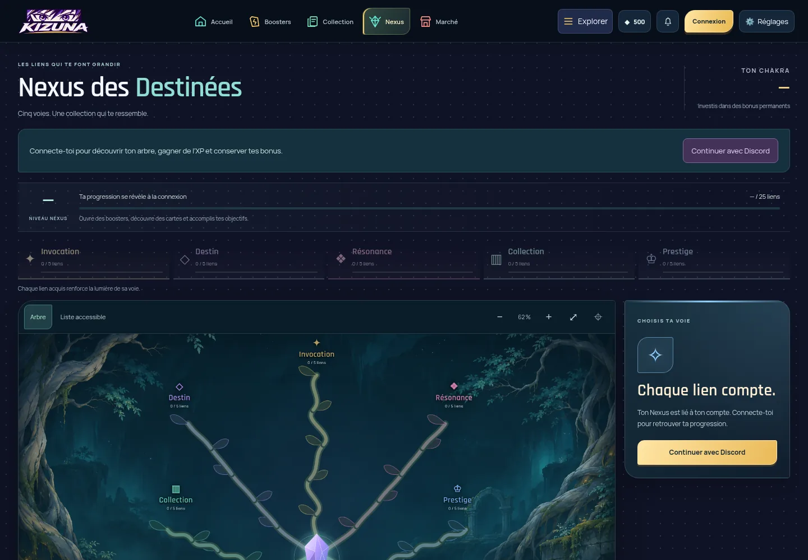
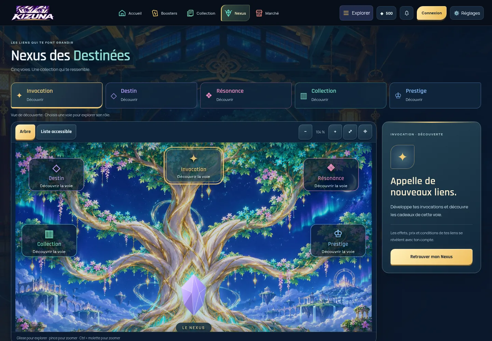
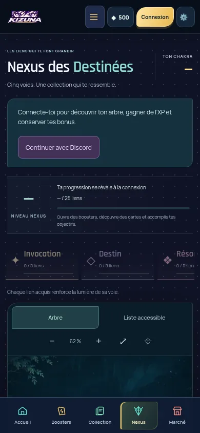
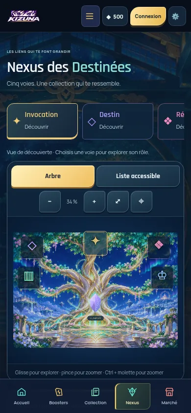
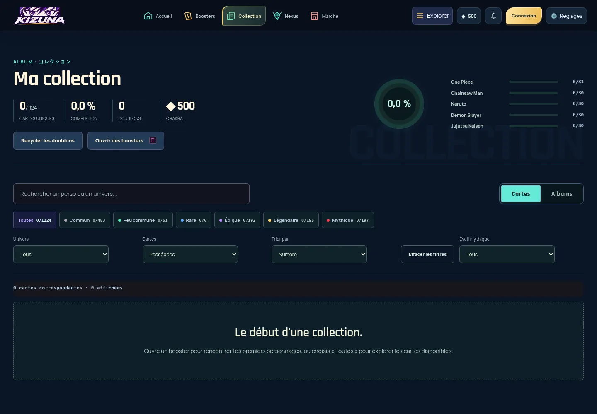
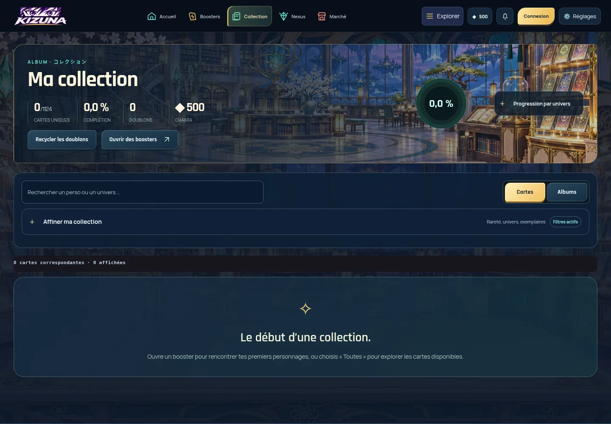
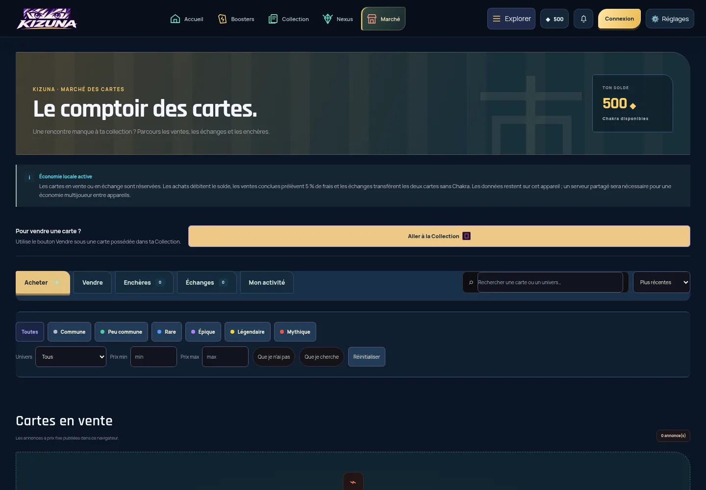
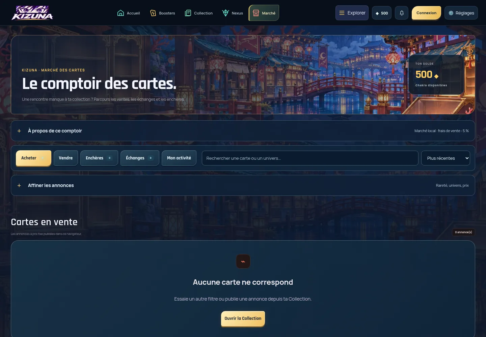
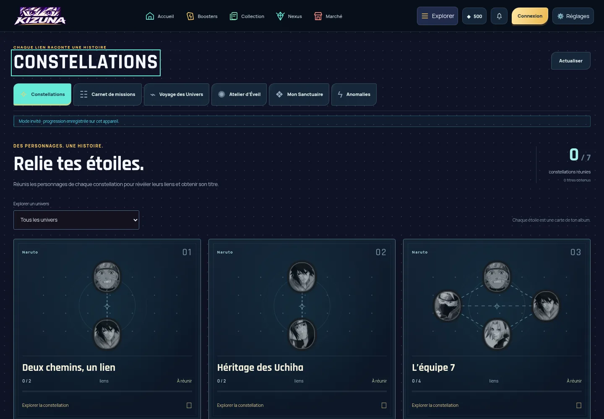
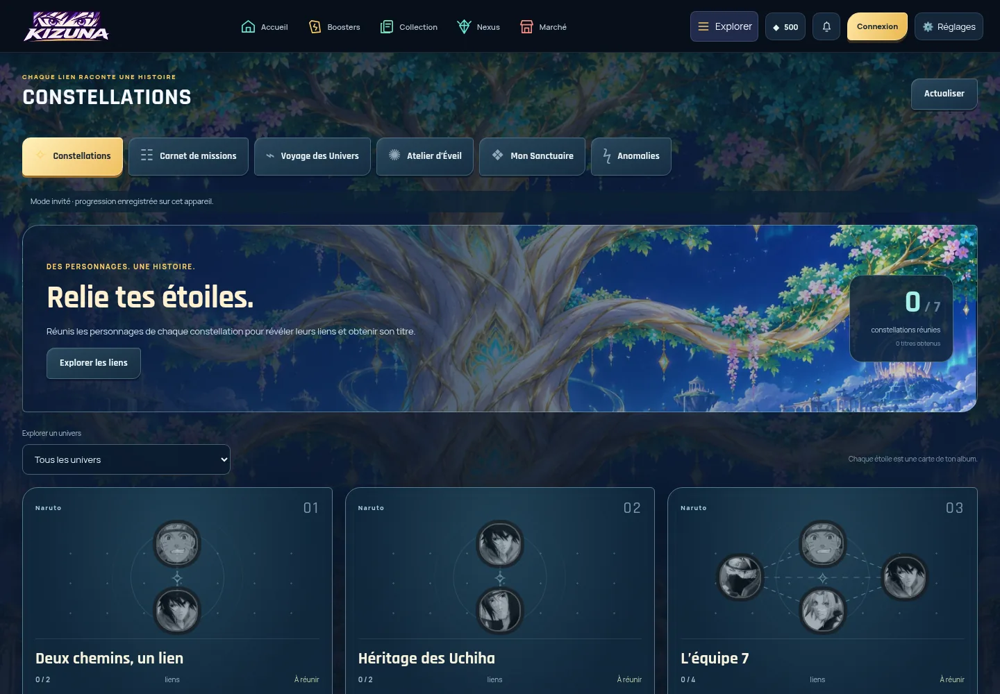

# Kizuna Rebirth — finition globale

Branche : `feature/kizuna-rebirth-finish`, basée sur `bee2895` (`main`). Cette passe est préparée pour revue : aucune fusion ni publication du site officiel.

## Audit et corrections

| Zone | Constat avant | Résultat de cette passe |
| --- | --- | --- |
| Nexus | Arbre filaire, cinq voies désactivées et répétitions de connexion en mode invité ; outils dispersés sur une longue page | Arbre illustré central, cinq voies de découverte cliquables, détail associé, liste accessible, cadrage et zoom adaptés. Les 25 nœuds réels restent exclusivement issus du compte. |
| Progression du Nexus | Récompenses, archives, statistiques et cosmétiques occupaient l’écran simultanément | Quatre tiroirs : trésors, rencontres, archives, Éveils. Un compteur de récompenses réelles reste visible lorsqu’il est fourni. Aucun achat ni bonus fictif. |
| Constellations | Atlas plat, grandes cartes, contrôles peu hiérarchisés | Scène céleste, entrée directe vers une constellation existante, portraits et connexions mieux détachés, panneaux de récompense et cartes compactes sur téléphone. |
| Collection / albums | Fond plat ; raretés et quatre sélecteurs avant les cartes | Bibliothèque illustrée, recherche et mode Cartes/Albums visibles ; filtres et progression par univers repliables. Le tiroir de filtres disparaît dans la liste des albums et revient dans leur détail. |
| Marché | Notice longue, bouton de vente redondant, filtres permanents | Bazar illustré, cinq onglets conservés, recherche immédiate, filtres et explications du marché local regroupés. Les frais de 5 % restent indiqués. |
| Wiki / univers | Encarts sans lieu distinct, contrôles omniprésents | Encyclopédie en bibliothèque, univers dans la cité ; recherche visible et options avancées regroupées. Les fiches et albums restent accessibles. |
| Communauté | Grandes tuiles, message réseau brut suivi d’un faux état vide | Salon de collectionneurs plus compact ; l’échec de chargement des galeries affiche un message de réessai et ne prétend plus que la liste est vide. |
| Classements | Gros bloc « à venir », doublon du parcours personnel | Salle de prestige, statut du classement partagé réduit à une note, détail du parcours repliable. Aucun joueur ni rang inventé. |
| Profil / Sanctuaire | Galerie suivie de tous les outils d’édition ouverts | Décor de galerie cohérent, atelier de composition fermé par défaut ; toutes les options, l’aperçu et la sauvegarde sont conservés. |
| Missions / Éveils / Anomalies | Titres encadrés et commandes hétérogènes, grands aplats | Navigation d’activités compacte, décors assortis, carnet et états indisponibles intégrés au même langage visuel. |
| Composants | Boutons, champs, onglets et dialogues de styles différents ; glyphes parfois absents | Boutons sculptés or/bleu, sélections explicites, focus visible, états désactivés, champs et dialogues harmonisés. Flèches fragiles remplacées par SVG. |

Le lobby et les invocations gardent leur composition Rebirth précédente. Leurs parcours sont inclus dans la régression. Les éléments économiques, le calcul des probabilités et les données persistées ne sont pas modifiés.

## Implémentation

- `dist/kizuna-finish.css` complète les styles de présentation en dernier dans la page.
- `dist/kizuna-finish.js` déplace les contrôles existants dans des éléments `<details>` natifs. Les éléments, identifiants et écouteurs restent les mêmes ; l’observation porte seulement sur les changements d’enfants, pas sur les transformations du graphe.
- `dist/kizuna-nexus.js` distingue découverte et progression réelle. En découverte, les boutons présentent uniquement le rôle des branches ; aucun coût, état acquis ou action d’achat n’est simulé. Sur mobile, sélectionner une branche réelle agrandit le nœud visé pour une cible d’au moins 44 px.
- `dist/kizuna-adventure.js` conserve les définitions, conditions, actions et sauvegardes. Seuls la présentation, l’entrée dans l’atlas, l’ouverture initiale de l’éditeur et le message d’échec de l’annuaire changent.
- Le fragment `src/ranking-view.inc.js` et sa copie injectée dans `dist/index.html` sont synchronisés.
- Trois décors originaux générés puis exportés en WebP : arbre, bibliothèque, bazar, 1,46 Mo au total. Aucun portrait de personnage n’est inventé.

## Vérifications exécutées

Build réussi : **1 526 fichiers, dont 1 449 médias archivés**. Vérification syntaxique JavaScript et `git diff --check` réussies.

```sh
node scripts/sync-feature-views.mjs
node scripts/sync-game-bridge.mjs
python3 scripts/build-netlify.py
KIZUNA_PLAYWRIGHT_MODULE=/chemin/vers/playwright-core node scripts/test-rebirth.cjs
KIZUNA_PLAYWRIGHT_MODULE=/chemin/vers/playwright-core node scripts/test-finish.cjs
KIZUNA_PLAYWRIGHT_MODULE=/chemin/vers/playwright-core node scripts/capture-finish.cjs
```

Les tests ouvrent un contexte invité neuf sur le serveur local (`KIZUNA_TEST_URL`, par défaut `http://127.0.0.1:8000`). Ils n’utilisent aucun compte de production.

- **Jeu existant** : annulation sans débit, tirage réel de cinq cartes et garantie Rare, révélation, fiche, favori, rechargement et persistance, 15 destinations, sélection de booster, probabilités affichées, cadeau quotidien, ouverture rapide de cinq boosters, préférences de mouvement et son, quatre tailles d’écran.
- **Finition** : recherche et filtres Collection, ouverture/retour d’album, filtres et cinq vues du Marché, filtre et fiche du Wiki, cinq voies invitées du Nexus, liste et zoom, carte d’une constellation et fiche de personnage, éditeur du Sanctuaire, échec et réessai de l’annuaire. Le snapshot économique est identique avant et après ces interactions de présentation.
- **Responsive** : 14 destinations à 360, 390, 768 et 1 440 px, sans débordement horizontal de la page ; rail d’activités et voies défilables à l’intérieur de leur zone. Les tests du jeu couvrent aussi 1 366 et 1 600 px.
- **Nexus isolé** : une fixture locale, explicitement synthétique, vérifie le rendu de 25 nœuds, les états acquis/disponible/verrouillé/à venir/chakra insuffisant, l’annulation de confirmation sans appel de mutation et le focus mobile agrandi. Ce test valide le rendu et les contrôles, pas le serveur.
- **Résultat** : aucune erreur JavaScript dans les deux suites.

### Limites de validation

Les achats et récompenses Nexus, synchronisations Supabase, connexion Discord et publication de Sanctuaires **n’ont pas été validés avec un compte distant**. Ils nécessitent une recette connectée avant validation de production. Les requêtes d’annuaire sont volontairement interrompues dans le test de panne ; aucun succès distant n’est revendiqué.

Certains portraits externes AniList renvoient HTTP 403 depuis cet environnement (par exemple Abdul Hakim). Les captures montrent alors un visuel « Illustration indisponible » ; la carte, son identité et ses actions restent présentes. Les portraits locaux continuent de s’afficher. Ce repli ne remplace jamais un personnage par une illustration inventée.

## Captures avant / après

Avant : commit `bee2895`. Après : cette branche. Même état invité vierge, zéro carte possédée, 500 chakra ; mouvement réduit. Ordinateur : 1 440 × 1 000. Mobile : 390 × 844. Les captures comparent des fenêtres visibles, pas des pages artificiellement remplies.

### Nexus

| Avant | Après |
| --- | --- |
|  |  |
|  |  |

### Collection et Marché

| Avant | Après |
| --- | --- |
|  |  |
|  |  |

### Constellations

| Avant | Après |
| --- | --- |
|  |  |

[Carte des liens sur ordinateur](rebirth-finish/after-desktop-constellation-detail.webp) · [Carte des liens sur téléphone](rebirth-finish/after-mobile-constellation-detail.webp)

### Toutes les rubriques

| Écran | Ordinateur | Téléphone |
| --- | --- | --- |
| Collection | [Avant](rebirth-finish/before-desktop-col.webp) · [Après](rebirth-finish/after-desktop-col.webp) | [Avant](rebirth-finish/before-mobile-col.webp) · [Après](rebirth-finish/after-mobile-col.webp) |
| Marché | [Avant](rebirth-finish/before-desktop-market.webp) · [Après](rebirth-finish/after-desktop-market.webp) | [Avant](rebirth-finish/before-mobile-market.webp) · [Après](rebirth-finish/after-mobile-market.webp) |
| Nexus | [Avant](rebirth-finish/before-desktop-nexus.webp) · [Après](rebirth-finish/after-desktop-nexus.webp) | [Avant](rebirth-finish/before-mobile-nexus.webp) · [Après](rebirth-finish/after-mobile-nexus.webp) |
| Univers | [Avant](rebirth-finish/before-desktop-universes.webp) · [Après](rebirth-finish/after-desktop-universes.webp) | [Avant](rebirth-finish/before-mobile-universes.webp) · [Après](rebirth-finish/after-mobile-universes.webp) |
| Wiki | [Avant](rebirth-finish/before-desktop-wiki.webp) · [Après](rebirth-finish/after-desktop-wiki.webp) | [Avant](rebirth-finish/before-mobile-wiki.webp) · [Après](rebirth-finish/after-mobile-wiki.webp) |
| Profil | [Avant](rebirth-finish/before-desktop-profile.webp) · [Après](rebirth-finish/after-desktop-profile.webp) | [Avant](rebirth-finish/before-mobile-profile.webp) · [Après](rebirth-finish/after-mobile-profile.webp) |
| Communauté | [Avant](rebirth-finish/before-desktop-community.webp) · [Après](rebirth-finish/after-desktop-community.webp) | [Avant](rebirth-finish/before-mobile-community.webp) · [Après](rebirth-finish/after-mobile-community.webp) |
| Classements | [Avant](rebirth-finish/before-desktop-rank.webp) · [Après](rebirth-finish/after-desktop-rank.webp) | [Avant](rebirth-finish/before-mobile-rank.webp) · [Après](rebirth-finish/after-mobile-rank.webp) |
| Constellations | [Avant](rebirth-finish/before-desktop-constellations.webp) · [Après](rebirth-finish/after-desktop-constellations.webp) | [Avant](rebirth-finish/before-mobile-constellations.webp) · [Après](rebirth-finish/after-mobile-constellations.webp) |
| Missions | [Avant](rebirth-finish/before-desktop-missions.webp) · [Après](rebirth-finish/after-desktop-missions.webp) | [Avant](rebirth-finish/before-mobile-missions.webp) · [Après](rebirth-finish/after-mobile-missions.webp) |
| Sanctuaire | [Avant](rebirth-finish/before-desktop-sanctuary.webp) · [Après](rebirth-finish/after-desktop-sanctuary.webp) | [Avant](rebirth-finish/before-mobile-sanctuary.webp) · [Après](rebirth-finish/after-mobile-sanctuary.webp) |
| Éveils | [Avant](rebirth-finish/before-desktop-awakening.webp) · [Après](rebirth-finish/after-desktop-awakening.webp) | [Avant](rebirth-finish/before-mobile-awakening.webp) · [Après](rebirth-finish/after-mobile-awakening.webp) |
| Anomalies | [Avant](rebirth-finish/before-desktop-events.webp) · [Après](rebirth-finish/after-desktop-events.webp) | [Avant](rebirth-finish/before-mobile-events.webp) · [Après](rebirth-finish/after-mobile-events.webp) |
